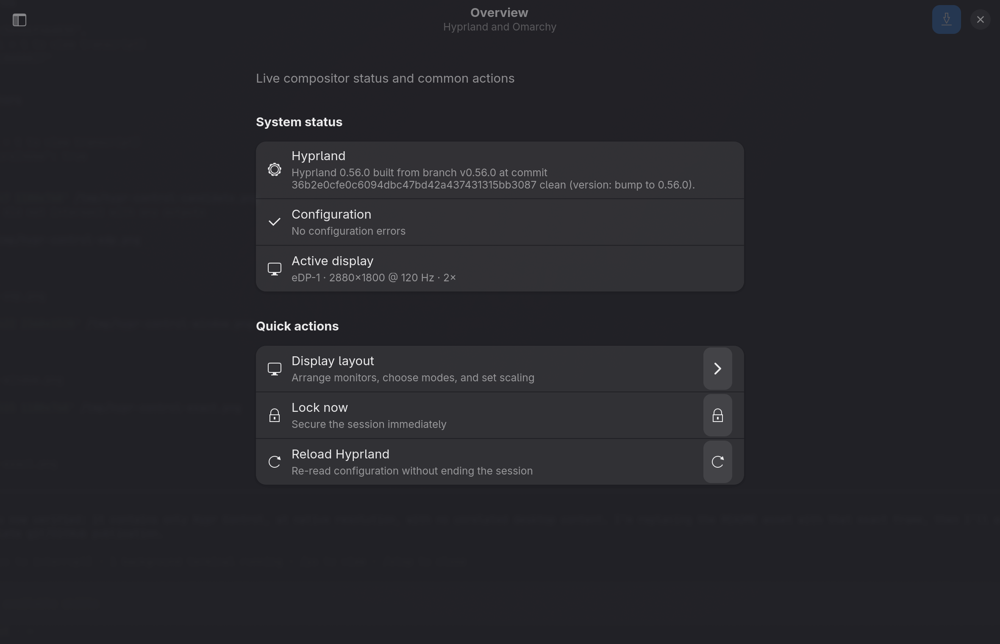

# Hypr Control

Hypr Control is a native GTK 4/libadwaita control center for Hyprland on [Omarchy](https://omarchy.org/). It puts everyday display, appearance, input, power, shortcut, and configuration controls in one focused application.

> Hypr Control is an independent community project. It is not affiliated with or endorsed by Hyprland or Omarchy.



## Features

- Live Hyprland, configuration, and monitor status
- Window gaps, borders, rounding, blur, shadows, dimming, and opacity
- Keyboard, pointer, and touchpad settings
- Omarchy themes, fonts, wallpapers, idle automation, locking, and night light
- Personal shortcut creation with live conflict detection
- Display layout handoff to `nwg-displays`
- Raw editor for user-owned Hyprland configuration files
- Automatic timestamped backups, `hyprctl configerrors` validation, and rollback

## Requirements

Hypr Control currently targets an up-to-date Omarchy installation. It expects:

- Python 3.11 or newer
- GTK 4, libadwaita, and PyGObject
- Hyprland and `hyprctl`
- Omarchy's `omarchy` command
- `nwg-displays` for the visual display layout editor

On Omarchy these dependencies are normally already installed. The app reads Omarchy's defaults when a split config file is not present and writes only to the user's XDG Hyprland config directory (normally `~/.config/hypr`).

## Install

```bash
git clone https://github.com/kasperhk/hypr-control.git
cd hypr-control
./install.sh
```

Ensure `~/.local/bin` is on `PATH`, then launch **Hypr Control** from the application menu or run:

```bash
hypr-control-center
```

To try it without installing:

```bash
./hypr-control-center
```

Set `PREFIX` to install under another user prefix:

```bash
PREFIX="$HOME/.local" ./install.sh
```

## Safety model

Before changing an existing file, Hypr Control creates a uniquely timestamped sibling backup named `*.bak.hypr-control-*`. Hyprland changes are reloaded and checked with `hyprctl configerrors`. Rejected changes are restored automatically; newly created files are removed on rollback. Idle-service changes are validated by restarting the corresponding Omarchy service.

The display layout editor is deliberately delegated to `nwg-displays`, which owns the generated monitor and workspace files on Omarchy.

## Development

The config parser and write/rollback behavior have no GUI dependency and can be tested with:

```bash
make test
```

Package metadata is included in `pyproject.toml`; the GTK/PyGObject runtime remains a system dependency rather than a PyPI dependency.

## License

[MIT](LICENSE)
