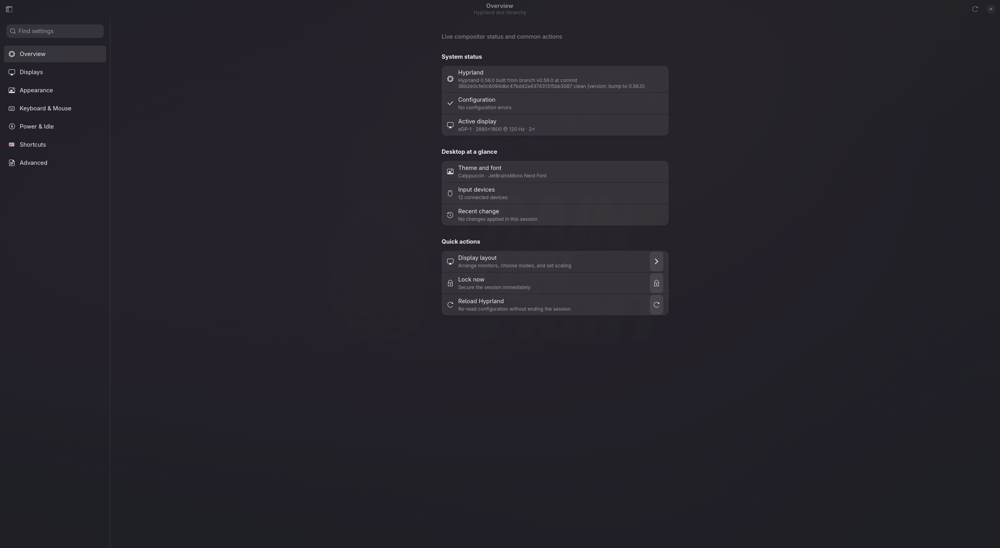
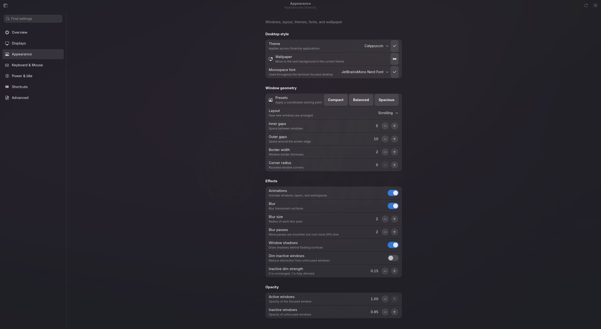
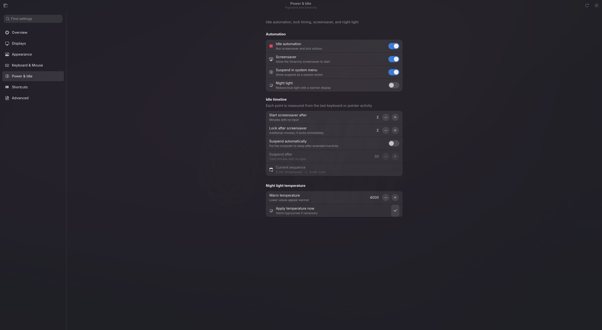

# Hypr Control

Hypr Control is a native GTK 4/libadwaita control center for Hyprland on [Omarchy](https://omarchy.org/). It puts everyday display, appearance, input, power, shortcut, and configuration controls in one focused application.

> Hypr Control is an independent community project. It is not affiliated with or endorsed by Hyprland or Omarchy.



| Appearance | Power & Idle |
| --- | --- |
|  |  |

## Features

- Live compositor, configuration, display, theme, font, and input-device status
- Native drag-and-drop display layouts with Extend, Mirror, External-only, and Internal-only modes
- Stable EDID- and dock-aware setup memory with automatic hotplug switching
- Per-output resolution, refresh rate, scaling, rotation, position, enablement, and 10-bit controls
- Omarchy themes, fonts, wallpapers, appearance presets, and detailed window effects
- Keyboard, pointer, touchpad, idle, locking, night-light, and power controls
- Direct shortcut capture with live, normalized conflict detection
- Search across settings, descriptions, and Hyprland keys with `Ctrl+K`
- A persistent pending-change bar with Apply and Discard actions
- Transactional multi-file saves, external-change protection, validation, and complete rollback
- Raw configuration editing with diff previews and browsable backup history
- Fifteen-second display previews with automatic recovery if a layout becomes unusable

## Requirements

Hypr Control currently targets an up-to-date Omarchy installation. It expects:

- Python 3.11 or newer
- GTK 4, libadwaita, and PyGObject
- Hyprland and `hyprctl`
- Omarchy's `omarchy` command

On Omarchy these dependencies are normally already installed. The app reads Omarchy's defaults when a split config file is not present and writes only to the user's XDG Hyprland config directory (normally `~/.config/hypr`).

## Install

```bash
git clone https://github.com/kasperhk/hypr-control.git
cd hypr-control
./install.sh
```

Ensure `~/.local/bin` is on `PATH`, then launch **Hypr Control** from the application menu or run:

```bash
hypr-control-center
```

To try it without installing:

```bash
./hypr-control-center
```

Set `PREFIX` to install under another user prefix:

```bash
PREFIX="$HOME/.local" ./install.sh
```

## Update

Pull the latest release from an existing clone and run the installer again:

```bash
cd hypr-control
git pull --ff-only
./install.sh
```

The installer replaces only Hypr Control's files under the selected user prefix. It does not modify your Hyprland configuration.

## Safety model

Before changing an existing file, Hypr Control creates a uniquely timestamped sibling backup named `*.bak.hypr-control-*`. A group of pending changes is treated as one transaction: Hyprland is reloaded, `hyprctl configerrors` is checked, and affected Omarchy services are restarted. If any write or validation step fails, every touched file is restored. Newly created files are removed on rollback. The newest 20 backups per file remain available from the Advanced page.

Hypr Control also records the user-owned file contents it loaded. If another application changes one of those files while settings are pending, applying stops instead of silently overwriting the external change.

Hypr Control owns the generated `~/.config/hypr/monitors.conf` file. Display
profiles are stored separately in
`~/.config/hypr-control/display-profiles.json`, identified by EDID and
connected dock rather than unstable connector names such as `DP-1`.

Display changes are previewed for 15 seconds. If they are not confirmed, the
previous monitor configuration is restored. The background display service
listens to Hyprland's monitor events, debounces multi-output docks, remembers
new hardware safely with automatic application disabled, and restores layouts
that have been confirmed in the control center.

## Display automation

The installer enables the user service automatically. Its command-line helper
can also inspect or change display state:

```bash
hypr-control-display status
hypr-control-display apply extend
hypr-control-display apply external --remember
hypr-control-display remember --name "Home desk"
```

### First connection

When a new monitor or dock is connected, Hypr Control records its EDID and dock
identity without changing the active layout. Open **Displays**, arrange the
outputs or select a quick mode, and confirm the 15-second preview. The setup is
then trusted and restored automatically whenever the same hardware reconnects.

The quick modes are:

| Mode | Behavior |
| --- | --- |
| Extend | Restores the remembered multi-display arrangement |
| Mirror | Mirrors every connected output using a shared supported mode when available |
| External only | Enables external outputs and safely disables the internal panel |
| Internal only | Enables the internal panel before disabling external outputs |

Automatic application can be disabled independently for any remembered setup
from the Displays page. Connector changes such as `DP-5` becoming `DP-1` do not
break matching because profiles use stable display and dock identity.

To disable or re-enable hotplug automation:

```bash
systemctl --user disable --now io.github.kasperhk.HyprControl.DisplayService.service
systemctl --user enable --now io.github.kasperhk.HyprControl.DisplayService.service
```

## Development

The config parser, display engine, profile matching, layout calculations, and
write/rollback behavior have no GUI dependency and can be tested with:

```bash
make test
```

Package metadata is included in `pyproject.toml`; the GTK/PyGObject runtime remains a system dependency rather than a PyPI dependency.

## License

[MIT](LICENSE)
